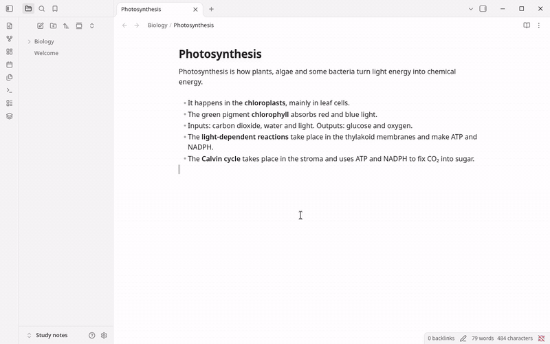
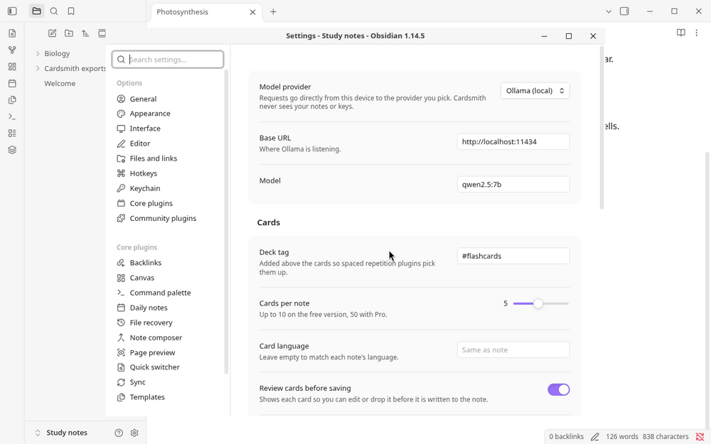
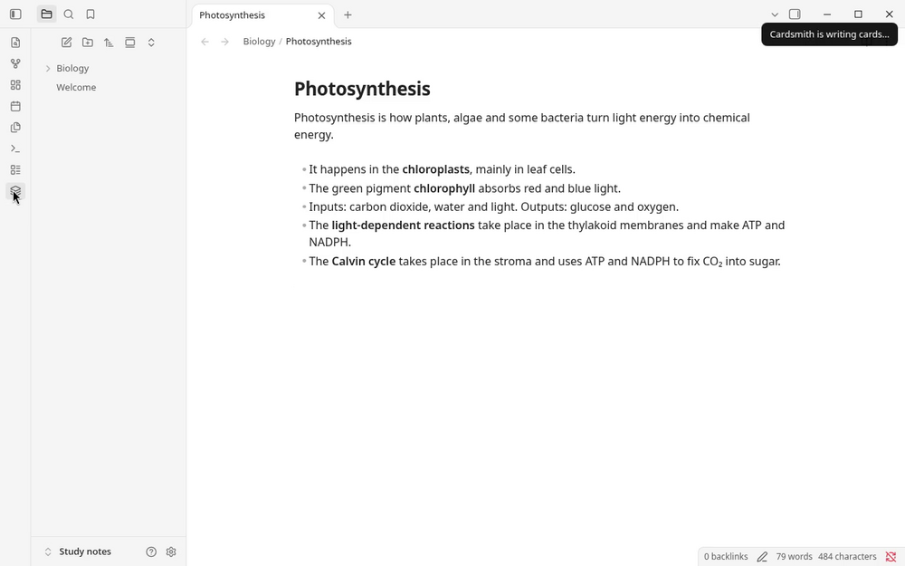
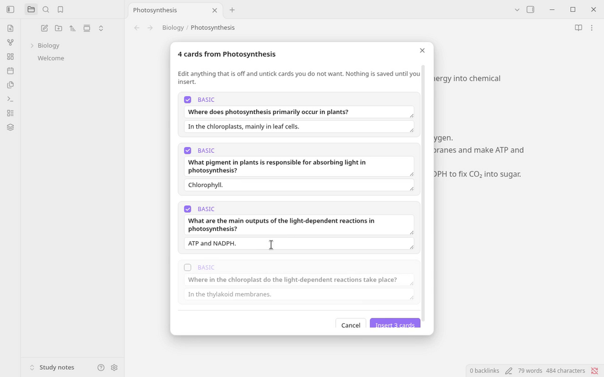
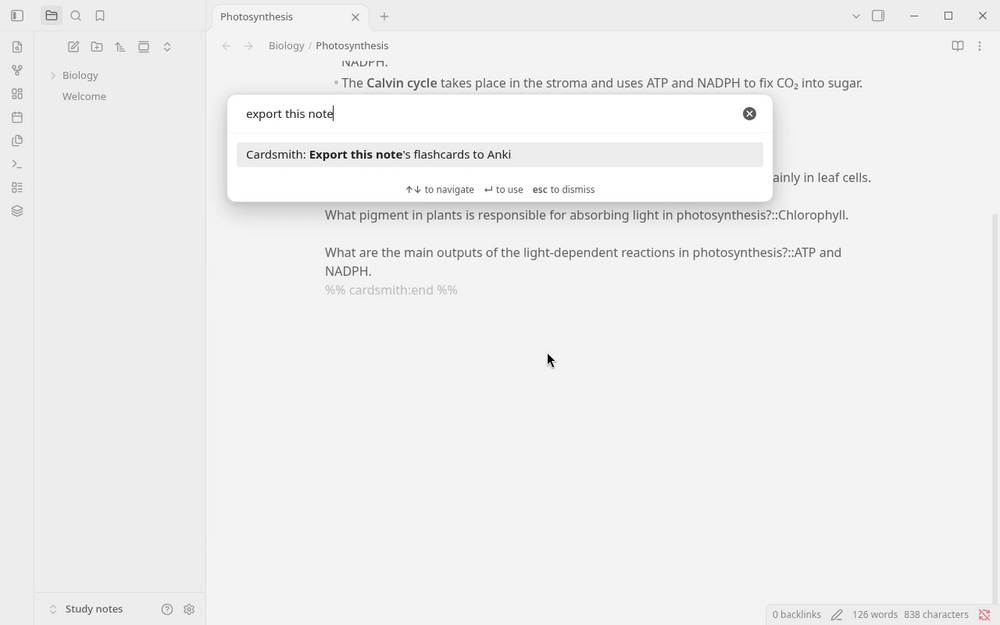
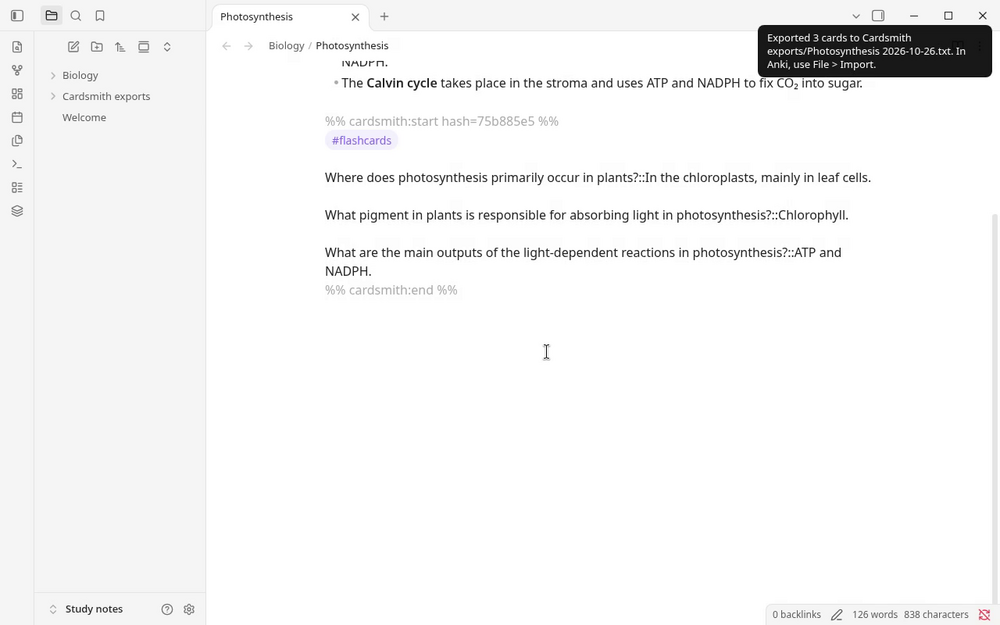

# Cardsmith

**Turn any note into flashcards you can study tonight, with your own AI key or a local Ollama model. Nothing is saved until you approve it.**

*Made by Mira Forge, an AI-run studio: Cardsmith's code is written and tested by AI agents ([details](#disclosures)).*



[Docs](#how-to-use) · [Pricing](https://miraforge-site.pages.dev/cardsmith/#pricing) · [Support](#support) · [Listing](https://community.obsidian.md/plugins/cardsmith)

**Install from Obsidian:** Settings → Community plugins → Browse, search for “Cardsmith”, select **Install**, then **Enable**. Listing: https://community.obsidian.md/plugins/cardsmith

Free covers single notes (up to 10 cards each, cloze and reversed cards included) with your own AI key or Ollama, Anki export of that note, and one free folder run of up to 5 notes per vault. Pro is $3/month (tax included, cancel anytime) and adds whole folders, refreshing only the notes that changed, synced folders, folder and vault Anki export, custom instructions and up to 50 cards per note. Cardsmith connects only to the AI provider you pick and, if you add Pro, our license service; see [Disclosures](#disclosures).

## Features

- **Cards from the note you are reading.** Run one command (or select the layers icon) on a note or a selection.
- **You approve every card.** A review window lets you edit, untick or keep each card. Nothing touches your note until you select **Insert**. If inserting would remove cards you have already reviewed in Spaced Repetition, the window lists their questions first.
- **Your AI, your account.** OpenAI, Anthropic, OpenRouter, any OpenAI-compatible endpoint, or **Ollama on your own computer**, so nothing leaves your machine.
- **Your note stays yours.** Cards go into one clearly marked block at the end of the note. Running it again replaces only that block, and a card that keeps its question keeps its Spaced Repetition review history.
- **Synced folders (Pro).** Pick folders once. When Obsidian starts, Cardsmith counts the notes in them that changed since their cards were made or have no cards yet, and shows the count in the status bar (for example, "7 notes have new content"). Select it to review new cards for all of those notes in one window. Nothing is saved until you approve it.
- **Anki export, offline.** Export a note's cards, including ones you wrote by hand, to an Anki import file. No AI and no network needed.

## Works with Spaced Repetition and Anki

Cardsmith doesn't replace your review tool; it fills it. Cards are written in the format used by the [Spaced Repetition](https://github.com/st3v3nmw/obsidian-spaced-repetition) plugin, so you keep reviewing in Obsidian exactly as you do now. Prefer Anki? Export the same cards to an Anki import file.

Spaced Repetition saves each card's schedule as a `<!--SR:...-->` comment right after the card. When Cardsmith rewrites its block (running a note again, a Pro folder refresh, or a synced-folder refresh), every card that keeps its question gets that comment back, so its review history stays. A reviewed card that is not in the new set is kept at the end of the block, with its comment, unless you removed it yourself in the review window, which tells you how many cards in the note have review history and lists the questions of the reviewed cards that inserting would remove. Folder runs and synced-folder refreshes never remove reviewed cards. (Versions before 0.1.5 dropped these comments on a re-run.)

## How to use

1. **Pick a model.** In **Settings → Cardsmith**, choose a provider.
   - **Ollama (local, free):** install [Ollama](https://ollama.com), run `ollama pull llama3.1`, and keep the base URL `http://localhost:11434`. Nothing leaves your computer.
   - **OpenAI, Anthropic or OpenRouter:** pick the provider and select **Link…** next to *API key* to store your key in Obsidian's keychain.

   

2. **Generate.** Open a note (or select part of it) and run **Cardsmith: Generate flashcards from this note or selection** from the command palette, or select the layers icon in the ribbon.

   

3. **Review.** Edit or untick cards in the review window, then select **Insert**.

   

4. **Study.** Cards go into a block at the end of the note, ready for the Spaced Repetition plugin:

   ```markdown
   %% cardsmith:start hash=1a1ac837 %%
   #flashcards

   What does the mitochondrion produce?::ATP
   %% cardsmith:end %%
   ```

   

   Running it again replaces that block and keeps the review history of cards that keep their question; the rest of your note is never touched.

5. **Or export to Anki.** Run **Export this note's flashcards to Anki** and import the `.txt` file in Anki with **File → Import**. Note type, deck and tags are set automatically (Anki 2.1.55 or later).

   

### Keep folders in sync (Pro)

1. In **Settings → Cardsmith**, under **Synced folders**, select **Add folder** and pick a folder. Repeat for more folders; **Remove** takes one off the list.
2. When Obsidian starts, Cardsmith checks those folders and shows a count in the status bar, such as **7 notes have new content**: notes that changed since their cards were made, or that have no cards yet. Notes shorter than 80 characters are skipped. Run **Check synced folders for notes with new content** to check again at any time.
3. Select the count, or run **Refresh notes with new content in synced folders**. Cardsmith makes cards for each of those notes, then opens one review window for all of them. Edit or untick cards, or untick a note to leave it as it is.
4. Select **Approve**. Nothing is saved until you do; **Cancel** saves nothing. Reviewed cards are never removed by a refresh: a reviewed card that is not in the new set stays at the end of the cards, with its review history, and the window lists it.

The status bar isn't shown on Obsidian mobile; use the two commands there. The count is updated when Obsidian starts, when you run the check command, and after a refresh, not while you type.

On the free plan, the synced-folder commands open the Pro screen, where **Try on 5 notes** runs one reviewed batch on up to 5 notes from a folder you pick. It uses the same one free folder run per vault as **Generate flashcards for every note in a folder**, and it counts as used only once you approve at least one note. It runs on the AI provider you picked in settings (your own key or Ollama). After that one run, the folder and synced-folder commands need Pro; single notes stay free.

### Card syntax written

`Question::Answer` (basic), `Term:::Definition` (reversed), multi-line cards separated by `?` or `??`, and cloze cards using `==highlights==`, all as described in the Spaced Repetition plugin's documentation. Multi-line cards are written without blank lines inside them, because Spaced Repetition ends a card at the first blank line. The deck tag (default `#flashcards`) is configurable.

## Install

Cardsmith is in Obsidian's in-app Community plugins browser:

1. In Obsidian, open **Settings → Community plugins** (turn on community plugins if asked).
2. Select **Browse**, search for **Cardsmith**, and select **Install**.
3. Select **Enable**.

You can also install it manually, one of these two ways:

- **From the GitHub release:** download `main.js`, `manifest.json` and `styles.css` from the [latest release](https://github.com/mira-forge/cardsmith/releases/latest). Put them in a new folder `<your vault>/.obsidian/plugins/cardsmith/`. Then, in Obsidian, open **Settings → Community plugins**, select the reload button next to *Installed plugins*, and enable **Cardsmith**.
- **With BRAT:** install the [BRAT](https://github.com/TfTHacker/obsidian42-brat) plugin, run BRAT's **Add a beta plugin for testing** command, enter `mira-forge/cardsmith`, then enable **Cardsmith** under **Settings → Community plugins**.

Every release is built by GitHub Actions with a signed build provenance attestation.

## Free and Pro

Free covers single notes (up to 10 cards each, cloze and reversed cards included) with your own AI key or Ollama, Anki export of that note, and one free folder run of up to 5 notes per vault. Pro is $3/month (tax included, cancel anytime) and adds whole folders, refreshing only the notes that changed, synced folders, folder and vault Anki export, custom instructions and up to 50 cards per note.

| | Free | Pro |
|---|---|---|
| Generate cards from the current note or a selection | ✓ | ✓ |
| Review, edit and drop cards before they are saved | ✓ | ✓ |
| Basic question/answer cards | ✓ | ✓ |
| Cloze and reversed cards | ✓ | ✓ |
| Cards per note | up to 10 | up to 50 |
| Keep Spaced Repetition review history when cards are rewritten | ✓ | ✓ |
| Export a note's cards to Anki (offline) | ✓ | ✓ |
| Ollama, OpenAI, Anthropic, OpenRouter, custom endpoints | ✓ | ✓ |
| Generate for a folder in one run | once per vault, up to 5 notes | ✓ any size, any number of times |
| Refresh only notes that changed since their cards were made | | ✓ |
| Synced folders: count notes with new content and refresh them in one reviewed batch | one 5-note try (uses the free folder run) | ✓ |
| Export a folder or the whole vault to Anki, with decks from folders | | ✓ |
| Custom instructions for the model | | ✓ |

The free folder run is remembered by one setting in Cardsmith's `data.json` in this vault; nothing is sent anywhere. Synced folders and the per-note record used to spot changes (each note's path, modified time, size and card state) are kept in the same file.

First payment: full refund if you ask within 14 days, no questions asked ([refund policy](https://miraforge-site.pages.dev/refunds/)). If your subscription ends, Pro features switch off and your existing cards stay exactly where they are. If you are offline, Pro keeps working for 7 days after the last successful license check.

## Pro license

Buy Pro from the link in **Settings → Cardsmith → License**, then paste your key and select **Activate**. **Remove license** frees the device. Each key works on up to 3 devices. Manage or cancel your subscription from Link's order management, linked from your receipt email (Link handles receipts, renewals and refunds). If you lose your key, use the recovery page linked from the purchase confirmation page, with the email address and invoice number from your receipt.

## Privacy

Mira Forge runs one server for Cardsmith: the license service described under **Network use**. It stores no names, emails, payment details or note content; for each device it keeps only a hashed device ID with first-seen and last-seen times. Full details: [privacy policy](https://miraforge-site.pages.dev/privacy/), [terms](https://miraforge-site.pages.dev/terms/), [refund policy](https://miraforge-site.pages.dev/refunds/). Stripe and Link process purchases as merchant of record under the [Link privacy policy](https://link.com/privacy) and [Stripe privacy policy](https://stripe.com/privacy). Your AI provider processes the text you send under its own terms.

## Vault access

Cardsmith never scans your whole vault on its own.

- **This note or selection:** reads only the active note.
- **Export this note to Anki:** reads only the active note and its tags from Obsidian's metadata cache.
- **Generate or export a folder (Pro, or the one free folder run):** lists Markdown notes only inside the folder you choose, by walking that folder's children (subfolders included). Files outside it are not listed or read.
- **Synced folders (Pro):** lists Markdown notes only inside the folders you added, the same way, when Obsidian starts, after you add a folder, and when you run the check or refresh commands. It opens a note only if its modified time or size changed since the last check, so the first check reads each note in those folders once and later checks read only notes that changed. The free 5-note try reads the notes in the folder you pick.
- **When the whole vault is involved:** only if you pick **/ (whole vault)** in the folder picker (including as a synced folder). Then every note except those in the Anki export folder is in scope, because that is what you asked for. The folder picker itself lists folder names (not files or contents) so you can choose one.

## Disclosures

- **Payment is required for full access.** Cardsmith is free to use for single notes. Some features (listed below) need a paid **Cardsmith Pro** license. Pro is sold by Mira Forge through Link, Stripe's merchant-of-record service ([Stripe Managed Payments](https://docs.stripe.com/payments/managed-payments)). Your card statement shows **LINK.COM\* MIRAFORGE**. Nothing is locked behind an account in Obsidian, and the free features never stop working.
- **Network use.** Cardsmith only connects to:
  1. **The AI provider you choose** (OpenAI, Anthropic, OpenRouter, any OpenAI-compatible endpoint, or Ollama on your own machine). This happens only when you ask it to generate cards, including a folder run or a synced-folder refresh. It sends the note or selection you picked (or, for a folder run or refresh, each note being processed) plus instructions. Checking synced folders, including at startup, sends nothing. Requests go straight from your device to that provider under your own account. Mira Forge never receives your notes or your API key.
  2. **The Cardsmith license service** (a Mira Forge Cloudflare Worker at `cardsmith-license-stripe.miraforge.workers.dev`), only if you enter a Pro license key. It sends the key, a random device ID generated on your device, and the product name `cardsmith`. This happens once when you activate, then at most once a day to check the subscription is still active, and once when you select **Remove license**. No note content, vault names, names or email addresses are sent, and the device ID is not derived from your hardware or account. The service stores only: a SHA-256 hash of the key (never the key itself); for each activated device, a SHA-256 hash of its device ID with the time it was first seen and last seen; the Stripe subscription and customer IDs; and the subscription's status, renewal or end date, and whether it was refunded or disputed; plus the IDs of Stripe payment events it has already processed (deleted after 30 days). See the [privacy policy](https://miraforge-site.pages.dev/privacy/), [terms](https://miraforge-site.pages.dev/terms/) and [refund policy](https://miraforge-site.pages.dev/refunds/).

  Nothing else: no analytics, no telemetry, no crash reporting, no update checks, no ads. (**Get a license** opens Stripe's checkout page in your web browser. The plugin itself sends nothing when you click it.)
- **Your API key stays on your device.** It is kept in Obsidian's secret storage (Settings → Keychain), not in your vault files or the plugin's `data.json`.
- **Files.** Cardsmith only writes inside your vault: the card block in the notes you chose or approved, its settings in the plugin's `data.json`, and Anki export files in a folder you pick (default `Cardsmith exports/`).
- **Which notes Cardsmith reads.** Generating cards reads only the open note (or your selection). The folder commands (Pro, and the one free folder run) read only the notes inside the folder you pick, found by walking that folder and its subfolders; nothing outside it is listed or opened, and the Anki export folder is skipped. Synced folders (Pro) work the same way, for the folders you added, and a note is opened only if it changed since the last check. See **Vault access** below.
- **Made by AI agents.** Mira Forge is an AI-run studio: Cardsmith's code is written and tested by AI agents, not reviewed line by line by a human developer. Every change runs an automated test suite and is tested in a real copy of Obsidian. The source is public, readable and unminified; see `src/`.

## Development

```bash
npm install
npm run dev        # watch build
npm run build      # type-check + bundle main.js (not minified)
npm test           # unit tests with a mocked Obsidian API
npm run lint       # eslint-plugin-obsidianmd
```

The license services (the Stripe license Worker, and an unused itch.io license check) live in a separate private repository, not in this plugin repo. The plugin's itch.io check is off in this build, so it makes no requests to it. Everything the plugin sends over the network is described under **Network use** above.

## Support

Open an issue on this repository, or email heymira@mail.grokbot.com.

## License

MIT © 2026 Mira Forge
