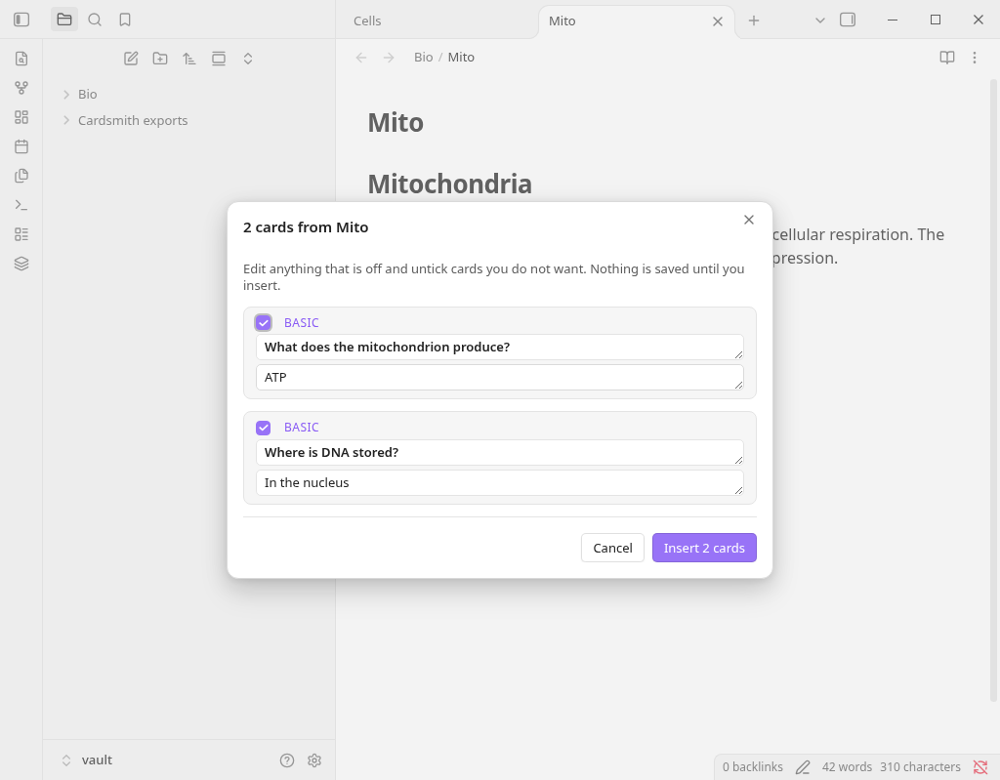

# Cardsmith

Turn your notes into spaced-repetition flashcards with your own AI key or a local Ollama model. Review every card before it is saved, then study in Obsidian or export to Anki.

Cardsmith writes cards in the format used by the [Spaced Repetition](https://github.com/st3v3nmw/obsidian-spaced-repetition) plugin, so they work with the review tools you already use. It also exports any Spaced Repetition card, including ones you wrote by hand, to an Anki import file, with no AI and no network.



## Disclosures

- **Payment is required for full access.** Cardsmith is free to use for single notes. Some features (listed below) need a paid **Cardsmith Pro** license. Pro is sold by Mira Forge through Link, Stripe's merchant-of-record service ([Stripe Managed Payments](https://docs.stripe.com/payments/managed-payments)). Your card statement shows **LINK.COM\* MIRAFORGE**. Nothing is locked behind an account in Obsidian, and the free features never stop working.
- **Network use.** Cardsmith only connects to:
  1. **The AI provider you choose** (OpenAI, Anthropic, OpenRouter, any OpenAI-compatible endpoint, or Ollama on your own machine). This happens only when you ask it to generate cards. It sends the note or selection you picked plus instructions. Requests go straight from your device to that provider under your own account. Mira Forge never receives your notes or your API key.
  2. **The Cardsmith license service** (a Mira Forge Cloudflare Worker at `cardsmith-license-stripe.miraforge.workers.dev`), only if you enter a Pro license key. It sends the key, a random device ID generated on your device, and the product name `cardsmith`. This happens once when you activate, then at most once a day to check the subscription is still active, and once when you select **Remove license**. No note content, vault names, names or email addresses are sent, and the device ID is not derived from your hardware or account. The service stores only a hash of the key, a hash of the device ID, the Stripe subscription and customer IDs, and the subscription's status and end date.

  Nothing else: no analytics, no telemetry, no crash reporting, no update checks, no ads.
- **Your API key stays on your device.** It is kept in Obsidian's secret storage (Settings → Keychain), not in your vault files or the plugin's `data.json`.
- **Files.** Cardsmith only writes inside your vault: the card block in the note you chose, and Anki export files in a folder you pick (default `Cardsmith exports/`).
- **AI-assisted code.** Much of this plugin's code was written with AI assistance, then reviewed and tested by Mira Forge. The source is readable and unminified; see `src/`.

## Free and Pro

| | Free | Pro |
|---|---|---|
| Generate cards from the current note or a selection | ✓ | ✓ |
| Review, edit and drop cards before they are saved | ✓ | ✓ |
| Basic question/answer cards | ✓ | ✓ |
| Cards per note | up to 10 | up to 50 |
| Export a note's cards to Anki (offline) | ✓ | ✓ |
| Ollama, OpenAI, Anthropic, OpenRouter, custom endpoints | ✓ | ✓ |
| Cloze and reversed cards | | ✓ |
| Generate for a whole folder in one run | | ✓ |
| Refresh only notes that changed since their cards were made | | ✓ |
| Export a folder or the whole vault to Anki, with decks from folders | | ✓ |
| Custom instructions for the model | | ✓ |

If your subscription ends, Pro features switch off and your existing cards stay exactly where they are. If you are offline, Pro keeps working for 7 days after the last successful license check.

## How to use

1. Install and enable Cardsmith. In **Settings → Cardsmith**, choose a model provider.
   - **Ollama (local, free):** install [Ollama](https://ollama.com), run `ollama pull llama3.1`, and keep the base URL `http://localhost:11434`. Nothing leaves your computer.
   - **OpenAI, Anthropic or OpenRouter:** pick the provider and select **Link…** next to *API key* to store your key in Obsidian's keychain.
2. Open a note (or select part of it) and run **Cardsmith: Generate flashcards from this note or selection** from the command palette, or select the layers icon in the ribbon.
3. Edit or untick cards in the review window, then select **Insert**. Cards go into a block at the end of the note:

   ```markdown
   %% cardsmith:start hash=1a1ac837 %%
   #flashcards

   What does the mitochondrion produce?::ATP
   %% cardsmith:end %%
   ```

   Running it again replaces that block; the rest of your note is never touched.
4. Study with the Spaced Repetition plugin, or run **Export this note's flashcards to Anki** and import the `.txt` file in Anki with **File → Import**. Note type, deck and tags are set automatically (Anki 2.1.55 or later).

### Card syntax written

`Question::Answer` (basic), `Term:::Definition` (reversed), multi-line cards separated by `?` or `??`, and cloze cards using `==highlights==`, all as described in the Spaced Repetition plugin's documentation. The deck tag (default `#flashcards`) is configurable.

## Pro license

Buy Pro from the link in **Settings → Cardsmith → License**, then paste your key and select **Activate**. **Remove license** frees the device. Each key works on up to 3 devices. Manage or cancel your subscription from Link's order management, linked from your receipt email (Link handles receipts, renewals and refunds). If you lose your key, use the recovery page linked from the purchase confirmation page, with the email address and invoice number from your receipt.

## Privacy

Mira Forge runs one server for Cardsmith: the license service described under **Network use**, which stores no names, emails or payment details. Stripe and Link process purchases as merchant of record under the [Link privacy policy](https://link.com/privacy) and [Stripe privacy policy](https://stripe.com/privacy). Your AI provider processes the text you send under its own terms.

## Development

```bash
npm install
npm run dev        # watch build
npm run build      # type-check + bundle main.js (not minified)
npm test           # unit tests with a mocked Obsidian API
npm run lint       # eslint-plugin-obsidianmd
```

The Stripe license service lives in a separate project (`cardsmith-license-stripe`). The original Polar rail is still in the code (`src/license/polar-provider.ts`) as a fallback, but it is inactive unless a build sets `LICENSE_RAIL = "polar"` in `src/config.ts`. With the default `"stripe"` setting, the plugin never contacts Polar.

`license-server/` holds an optional, currently unused license check for itch.io purchases (itch.io's API needs a secret key, so it cannot run in the plugin). It is off in this build: with it off, the plugin makes no requests to it.

## Support

Open an issue on this repository, or email heymira@mail.grokbot.com.

## License

MIT © 2026 Mira Forge
